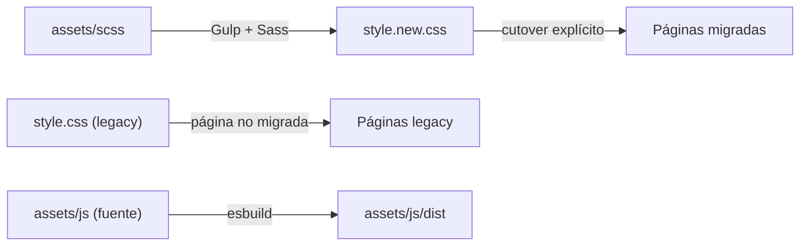

# Arquitectura — The Clandestino USA

Describe la arquitectura **vigente** y el **objetivo inmediato**. Lo marcado como *futuro* aún no existe en el repo.

## Vigente

- Páginas `.html` estáticas y PHP puntual (`contact.php`, `reservation.php`).
- CSS legacy en `assets/css/` (`style.css`, `style.min.css` y hojas específicas como `faq-styles.css`, `form-feedback.css`, `pure-soul.css`, `whatsapp-float.css`).
- JavaScript por página en `assets/js/` (scripts sueltos, sin bundler).
- Hosting: GoDaddy shared (cPanel). Despliegue de archivos estáticos y PHP simple.
- Inventario de UI actual: `docs/LEGACY-UI-INVENTORY.md`.

## Tooling frontend (vigente)

Pipeline en `gulpfile.mjs`. Compila la foundation SCSS y el JS nuevo. El legacy no se compila ni se modifica.

| Pieza | Detalle |
|---|---|
| Sass producto | `assets/scss/main.scss` → `assets/css/style.new.css` |
| Sass guía | `assets/scss/style-guide.scss` → `assets/css/style-guide.css`, solo en `npm run dev` |
| Bootstrap | 5.3.x desde `node_modules`: núcleo y mecánica transitions/modal/toasts; JS modular solo en la guía |
| PostCSS | Autoprefixer siempre; cssnano solo en `build` |
| JS | Entrada `assets/js/main.js` → `assets/js/dist/main.js` (esbuild, ESM, `es2020`) |
| JS guía | `assets/js/style-guide.js` → `assets/js/dist/style-guide.js`, solo dev |
| Iconos | `bootstrap-icons@1.13.1` (devDependency) → sprite local curado `assets/icons/cl-iconos.svg`, dev/build |
| PHP local | `php -S 127.0.0.1:8000` lanzado por Gulp y cerrado al salir |
| BrowserSync | `http://localhost:3000` con proxy a PHP `:8000` (PHP real, no estáticos) |
| Lint | ESLint (JS nuevo y `.mjs` de tooling) y Stylelint (`assets/scss/**`) |

Comandos: `npm run dev` (clean → CSS de producto y de guía, con sourcemaps, más JS → PHP → BrowserSync → watch), `npm run build` (clean → `style.new.css` y JS minificados, sin sourcemaps, sin servidores y sin CSS de la guía), `npm run lint`.

Outputs (ignorados por git): `assets/css/style.new.css`, sus sourcemaps, `assets/css/style-guide.css` (+ `.map`, solo dev), `assets/js/dist/**` y `assets/icons/cl-iconos.svg`. `clean` borra únicamente estos. `npm run build` no deja CSS/JS de guía y genera siempre el sprite. Todo futuro paquete de release deberá incluir el sprite generado.

Dev compila ambas entradas JS; build solo main.js. Main no importa Core mientras ninguna página lo utiliza. Watch incluye `style-guide/**/*.php`, entrada JS de guía, módulos Core y fuentes del sprite. `npm run icons` regenera el sprite sin servidores.

Separación legacy/new: los cambios en HTML/PHP/CSS/JS legacy solo recargan BrowserSync; no se compilan, optimizan ni regeneran (imágenes, sitemap).

## SCSS foundation (vigente)

Design system oscuro, todavía sin páginas de producto migradas. Entrada: `assets/scss/main.scss`.

```text
assets/scss/
├── main.scss                 # bundle de producto → style.new.css
├── style-guide.scss          # solo dev → style-guide.css
├── abstracts/_tokens.scss    # primitivos y overrides de Bootstrap
├── base/                     # custom properties, tipo, accesibilidad
├── components/               # Foundation y Core
└── patterns/                 # Wave 1 estructural y Wave 2 gastronómica
```

`components/_guia.scss` (clases `cl-guia-*` y `cl-muestra-*`) presenta las dos páginas de guía. Entra por `style-guide.scss`, no por `main.scss`, para que no infle el bundle de producto.

Los primitivos viven en SCSS y no se copian todos a `:root`. Las custom properties semánticas (`--color-fondo`, `--fuente-cuerpo`, `--espacio-1`…`--espacio-9`, etc.) salen de `base/_root.scss`. Los componentes leen esas variables.

Bootstrap 5.3 se personaliza entre `functions` y `variables`. `$enable-dark-mode: false`. Con eso, el build compila sin `variables-dark` y no genera `[data-bs-theme="dark"]`. El selector `[data-bs-theme="light"]` lo emite el propio `root` de Bootstrap junto a `:root` y no activa un tema claro.

Tipografía: Libre Bodoni en display y headings; Playfair Display solo en la cita editorial (`.cl-cita`); cuerpo, botones, labels y campos en la sans de sistema. No se descarga una fuente nueva. No se redefine `html { font-size }`.

Paleta de partida aprobada, con un ajuste medido: el borde fuerte pasa de 28% a 40% de cream (`rgb(243 239 230 / 40%)`) porque 28% quedaba ~2.3:1 y no identificaba un control. A 40% el mínimo medido es 3.33:1 sobre `neutral-700`. El borde al 12% sigue siendo decorativo. El vino no se usa como texto sobre el fondo (1.79:1). El resto de pares de texto usados superan 4.5:1; el detalle está en la guía, sección Colors.

### Style guide

`style-guide/index.php` presenta Foundations/Core y `style-guide/patterns.php`, Section Patterns. Ambas enlazan `assets/css/style.new.css` y, después, `assets/css/style-guide.css`, con las fuentes existentes (Libre Bodoni/Playfair). Comparten un pequeño partial de navegación con enlaces HTML y `aria-current`. Patterns incluye composiciones estáticas y demos locales de productos mediante la misma entrada JS de guía. Ninguna carga CSS/JS legacy. `style-guide.css` es exclusivo de desarrollo; build no lo genera.

En Apache/GoDaddy, `.htaccess` responde 403 a `^style-guide(/|$)` sin tocar los assets compartidos. El servidor embebido de PHP ignora `.htaccess`, así que `http://localhost:3000/style-guide/` sigue visible en local. `robots.txt` no es el mecanismo de bloqueo.

### Hojas legacy y cutover

`style.css` fija `html { font-size: 10px }`. La foundation usa la raíz del navegador. Cargar las dos hojas en la misma página hace que `rem` signifique dos cosas distintas. Multiplicar tamaños por 1.6 no es una migración válida.

Una página migrada depende del sistema nuevo. No carga a la vez, para compensar estilos que falten:

- `style.css`
- `style.min.css`
- hojas CSS específicas del legacy (`faq-styles.css`, `form-feedback.css`, `pure-soul.css`, `whatsapp-float.css` y las que se sumen)

Si una migración futura necesita una excepción temporal, el PR tiene que declararla, justificarla, nombrar el selector o la feature que la obliga y decir cuándo se elimina. No hay capa de compatibilidad ni se toca la raíz del legacy.

Cada cutover es un commit de una página, verificado con la skill `qa-visual` en 390, 768 y 1280. Ninguna página de producción enlaza `style.new.css` todavía.

### Core Component Library

Core amplía los controles genéricos: iconografía, feedback, estados, toast, modal, disclosure, formularios, cantidad, loading, vacío/error y breadcrumb. Componentes reales en `style.new.css`; presentación y demos en CSS/JS de guía exclusivamente dev. No migra páginas ni introduce lógica de negocio. Documentación, contratos y registro técnico en `docs/CORE-COMPONENT-LIBRARY.md`. La aprobación visual humana es requisito previo al merge.

### Pattern Library — Wave 1

Los cuatro patrones se importan después de Core en `main.scss`, sin JavaScript nuevo. Solo `style-guide/patterns.php` incluye `partials/patrones-wave-1.php` con `require`/`__DIR__`; el bloqueo Apache existente cubre ambas páginas y sus partials. Hero superpuesto desde móvil, Media + Content desde md y CTA centrado; contratos, imágenes, QA y carrusel futuro de Home: `docs/SECTION-PATTERN-LIBRARY.md`. Sin motor de plantillas ni migración productiva; aprobación visual humana pendiente.

### Pattern Library — Wave 2 (vigente, pendiente de aprobación visual)

Cuatro partials de producto amplían `main.scss`: tarjeta gastronómica compartida, fila de menú, media/ficha de vino y composición de catálogo. No cambia Foundation/Core ni los layouts Wave 1. La tarjeta Foundation y `cl-media-contenido` se reutilizan también para quesos, cestas y destacados. Demos en tres partials locales de `patterns.php`; `modules/guia/productos.js` entra exclusivamente por `style-guide.js`. La misma entrada conecta Core o productos según los elementos presentes. `main.js` continúa sin imports; build excluye las demos. No hay backend, requests de negocio ni persistencia. Inventario, matriz, assets y validación: `SECTION-PATTERN-LIBRARY.md`.

### Pattern Library — Wave 4

Cuatro partials SCSS de producto añaden membresía, regalo, evento/agenda y consulta privada. `style-guide/patterns.php` incluye una entrada PHP Wave 4, cuatro familias y laboratorio de estados; reutiliza Core, Waves anteriores y fotografía existente. `modules/guia/comercial.js` conecta demostraciones locales exclusivamente desde `style-guide.js`, sin requests ni persistencia. CSS de laboratorio permanece en `_guia.scss`. No cambia el bundle JS productivo, el tooling ni las páginas legacy. Cobertura, contratos conceptuales de UI, QA, performance y pendientes comerciales: `SECTION-PATTERN-LIBRARY.md`. Aprobación visual humana pendiente.

### Pattern Library — Wave 6

`patterns/_navegacion-global.scss` y `_pie-global.scss` preparan Header sticky, drawer móvil/tablet, Footer/contacto y extensiones contextuales de breadcrumbs Core. `modules/patterns/navegacion-global.js` usa Bootstrap Offcanvas individual, Collapse para Discover y observers; solo `style-guide.js` lo inicializa. `_acceso.scss` y `modules/patterns/acceso.js` reutilizan Core Modal, campos, carga y alertas para acceso exclusivamente sintético, sin autenticación ni envío de credenciales. `style-guide/navigation.php` es laboratorio aislado, embebido mediante iframe lazy en Patterns y accesible a viewport completo; no es página productiva. Partials PHP comparten mapas de destinos demostrativos y un CTA de reservas sin motor. El logo UI es un derivado optimizado; el original permanece intacto. Contratos de configuración futura, cobertura, datos, QA, performance y pendientes en `SECTION-PATTERN-LIBRARY.md`. Sin cambios en main.js, backend ni páginas legacy; aprobación visual humana pendiente.

### Pattern Library — Wave 7

Tres partials SCSS (`transaccion`, `carrito`, `reserva`) añaden composiciones de operación sobre Foundation/Core. Los módulos `patterns/{transaccion,estado-carrito,carrito,promocion,checkout,reserva}.js` separan estado de compra, presentación y callbacks de contexto; el snapshot versionado alimenta Cart/Order/Payment y el contador optativo de Header Wave6; `modules/guia/transacciones.js` y `transacciones-fixtures.js` conectan exclusivamente el laboratorio desde `style-guide.js`. PHP de referencia en `style-guide/partials/*wave-7.php` y `transacciones-componentes.php`; incluye Header/Footer/acceso Wave 6 existentes. No hay requests comerciales ni persistencia. `main.js` permanece vacío y el build excluye el JS de guía. Contratos futuros y QA en `SECTION-PATTERN-LIBRARY.md` / `WAVE-7-COVERAGE.md`; índice para construir páginas en `DESIGN-SYSTEM-READINESS.md`. La aprobación visual humana sigue pendiente.

## Objetivo inmediato (futuro)

Wave 6 mantiene partials compartidos de Header/Footer/modal y Topbar opcional. Los datos/rutas de la muestra se concentran en `style-guide/partials/configuracion-wave-6.php` (fixture local, no configuración productiva). El anfitrión futuro aportará configuración central confiable de rutas, contacto/redes y campos opcionales antes de incluir los mismos partials; no se migra ninguna página en esta wave. Topbar no sticky, omitida por defecto; contrato y QA de cierre en `SECTION-PATTERN-LIBRARY.md`.

| Capa | Objetivo |
|---|---|
| Estilos | Foundation, Core y Wave 1 estructural; aprobar visualmente los patrones antes de migrar páginas |
| JavaScript | Módulos en `assets/js/modules/**` importados desde `main.js` |
| PHP | Simple primero; estructura solo cuando la complejidad lo pida |
| Datos | MySQL solo cuando una feature (checkout, Wine Club, reservas) lo requiera |

## Estrategia CSS: migración incremental

- `style.css` es **legacy** y sigue siendo el CSS de producción hasta su cutover.
- `style.new.css` es el **output** de la foundation. Hoy solo lo carga `style-guide/index.php`.
- La migración es **página por página**: se quita el CSS legacy de esa página, se enlaza `style.new.css` y se reescribe el markup a `cl-` y al grid.
- Una página migrada no carga el CSS legacy y el nuevo a la vez para tapar huecos. La excepción temporal, si existiera, se documenta en el PR con selector, motivo y retirada.
- No hay hoja que compense la raíz de 10px del legacy.
- Verificación de cada cutover: skill `qa-visual`.



## Reglas de arquitectura

- Refactor incremental del código existente; sin Laravel, React ni plantillas de terceros.
- Sin Redis, colas ni procesos persistentes (limitación del hosting).
- PHP: validación de input, escaping de output, CSRF en POST nuevos, importes recalculados en servidor.
- Los cambios de arquitectura se documentan aquí en el mismo commit que los introduce.


### Extensión de comercio Wave7

`patterns/mini-carrito.js` proyecta el proveedor observable de `carrito.js` dentro de Offcanvas; Header recibe proveedor/panel explícitos. `paginacion-carrito.js` separa diez líneas visibles del estado global producto/variante/línea. `horario-servicio.js` concentra lógica civil de configuración por servicio/excepción y `horario-formulario.js` adapta selectores nativos; reservas consume esa misma fuente. Fixtures permanecen en `modules/guia/transacciones-fixtures.js`, sin persistencia ni backend. Contratos y QA del cierre2026-10-21 en `WAVE-7-COVERAGE.md`.

## Vista previa local de Home — 2026-10-21

La primera integración de `home-preview.php` fue rechazada visualmente. Sus pruebas técnicas anteriores no aprueban el diseño. La reconstrucción y su evidencia actual están en [HOME-HEADER-HERO-REWORK.md](HOME-HEADER-HERO-REWORK.md).

El anfitrión incluye el Header y el acceso Wave 6 existentes, con navegación real, cuenta demostrativa y carrito neutral sin proveedor ni unidades ficticias. Experiences apunta provisionalmente a `/index.html#services`; Reserve a Table a `/index.html#reservation`; Explore Wines a `/wines.html`. No hay autenticación ni operación comercial nueva.

`assets/scss/home.scss` compila a `assets/css/home.css` con el pipeline reducido existente. Incluye las dependencias Core/Bootstrap reales de navegación, Modal y acceso, sin hojas legacy ni CSS/JS de guía. `main.js` inicializa solo `[data-cl-home-preview]`; no importa `modules/guia/**` ni fixtures.

El Hero editorial se comparte mediante style-guide/partials/hero-editorial-wave-1.php entre Patterns, Navigation y Home; imagen y copy conservan grid 1/1, columnas 12/10/7, tipo, padding y botones Wave 1. Solo Home retira el pseudo-elemento radial del copy, sin cambiar _hero.scss. El ajuste de legibilidad autorizado aplica ahora una capa cálida sobre el media: base 14% y refuerzo continuo más concentrado (61% máximo), vertical/lateral, sin cambiar composición. Contraste muestreado: título mínimo 4,98:1 y descripción 5,48:1; diseño considerado satisfactorio por el usuario en la solicitud de entrega final; revisión de integración pendiente. Las diferencias autorizadas son datos, carga y semántica del anfitrión. escenas-hero.js conserva intervalo 6,5 s, loop y bullets, con causas de pausa separadas; hover/foco/visibilidad/intersección recuperables, pausa manual persistente y reduced motion sin autoplay. Foto funde 720ms; contenido entra 520ms/8px y termina sin transformaciones. Pausa accesible al foco e inactivos inert/aria-hidden, sin flechas ni librerías nuevas. WebP posteriores se materializan desde template; PNG intactos.

El Header conserva el partial y composición Wave 6, incluido el badge numérico conocido 0. Se retira el bloque adicional de acciones del drawer y sus estilos/lógica exclusivos por instrucción del usuario. Cart/Account permanecen únicamente en sus controles originales: operativos con drawer cerrado, bloqueados por el panel/backdrop y trap mientras está abierto. No se anuncian como accesibles durante esa apertura ni se crea otro bloque equivalente. Home aporta cero demostrativo, sin proveedor comercial; null permanece desconocido y el badge limita cifras grandes a 99+.

El Header recibe la fábrica de mini-carrito solo cuando su anfitrión la necesita: `conectarCarrito(proveedor, panel, inicializarMiniCarrito)` o la opción `crearMiniCarrito`. Home no la conecta; el laboratorio transaccional sí. La corrección de foco tras reubicar el activador se comparte entre Home y guía.

La entrada del módulo Home declara blocking=render para evitar el salto del fallback de navegación expandido al drawer durante el primer pintado; verificación actual en Chromium. Vista limitada a PHP built-in (`cli-server`), 404 fuera de ese entorno, `noindex, nofollow`. No cambia `index.html`, la resolución pública de `/` ni el hosting. Revisión: `npm run dev` → `http://localhost:3000/home-preview.php`. El usuario autoriza publicar la feature para revisión hacia develop, sin crear PR automáticamente ni desplegar; QA de cierre y límites en el informe enlazado.
